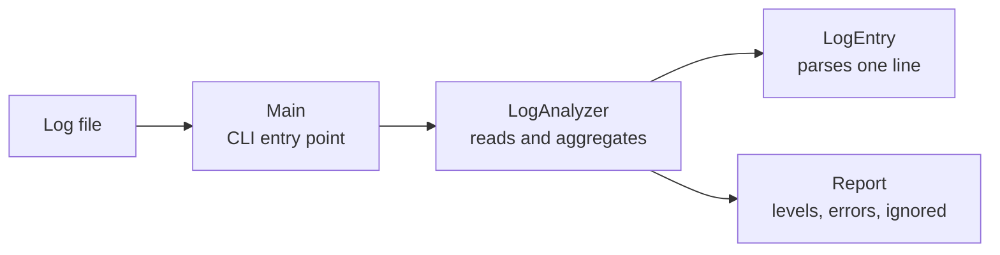

<div align="center">

# 🔎 LogLens

### A fast, lightweight command-line log analyzer for Java applications

Turn hundreds of raw log lines into a clear, structured summary: level counts, extracted errors, and malformed-entry detection.

[](https://github.com/YOUR_USERNAME/LogLens/actions)


[](LICENSE)


[Features](#-features) · [Quick Start](#-quick-start) · [Usage](#-usage) · [Log Format](#-supported-log-format) · [Architecture](#-architecture) · [Roadmap](#-roadmap) · [Contributing](#-contributing)

</div>

---

## 📖 Overview

Reading through hundreds of log entries to find out what went wrong is slow and error-prone. **LogLens** parses your application log file in a single pass and gives you a concise report: how many entries of each level, which errors occurred and when, and which lines could not be parsed.

It is built with plain Java and Maven, has no runtime dependencies, and is covered by JUnit 5 tests that run automatically on every push through GitHub Actions.

## ✨ Features

| Feature | Description |
|---|---|
| 📄 **Log parsing** | Supports `DEBUG`, `INFO`, `WARN`, `WARNING`, and `ERROR` levels |
| 📊 **Level statistics** | Counts occurrences of each log level |
| 🚨 **Error extraction** | Lists every error message together with its timestamp |
| 🧹 **Malformed-entry handling** | Detects invalid lines, ignores them safely, and reports how many were skipped |
| 💻 **CLI interface** | One command, one argument: the path to your log file |
| ✅ **Unit tested** | JUnit 5 test coverage for parsing and analysis logic |
| 🔁 **Continuous integration** | GitHub Actions builds and tests every change |

## 🛠️ Tech Stack

| Technology | Purpose |
|---|---|
| Java 17 | Core application |
| Maven | Build and dependency management |
| JUnit 5 | Unit testing |
| GitHub Actions | Continuous integration |

## 🚀 Quick Start

### Prerequisites

- JDK 17 or later
- Apache Maven 3.8 or later
- Git (optional)

### Install and run

```bash
# 1. Clone the repository
git clone https://github.com/YOUR_USERNAME/LogLens.git
cd LogLens

# 2. Build and package
mvn clean package

# 3. Analyze the included sample log
java -jar target/loglens-1.0.0.jar sample-logs/application.log
```

### Run the tests

```bash
mvn test
```

## 💡 Usage

```bash
java -jar target/loglens-1.0.0.jar <path-to-log-file>
```

| Argument | Description |
|---|---|
| `<path-to-log-file>` | Path to the log file you want to analyze |

Analyze your own logs:

```bash
java -jar target/loglens-1.0.0.jar /var/log/myapp/application.log
```

## 📝 Supported Log Format

LogLens currently reads timestamped entries in this format:

```text
YYYY-MM-DD HH:MM:SS LEVEL - MESSAGE
```

**Example:**

```text
2026-11-14 09:00:00 INFO - Application started
2026-11-14 09:01:00 DEBUG - Loading configuration
2026-11-14 09:02:00 WARN - High memory usage
2026-11-14 09:03:00 ERROR - Database connection failed
```

Lines that do not match this format are counted as **ignored** and do not stop the analysis.

## 📊 Example Output

```text
=== LOGLENS REPORT ===

Total lines: 7 | Parsed: 6 | Ignored: 1

Log levels:
  DEBUG 1
  INFO  2
  WARN  1
  ERROR 2

Errors:
  [2026-11-14T09:03:05] Database connection timed out
  [2026-11-14T09:05] Retry failed: connection refused
```

## 🏗️ Architecture



### Project structure

```text
LogLens/
├── .github/
│   └── workflows/
│       └── ci.yml              CI: build and test on every push
├── sample-logs/
│   └── application.log         Sample input for trying LogLens
├── src/
│   ├── main/java/dev/loglens/
│   │   ├── Main.java           CLI entry point
│   │   ├── LogEntry.java       Log entry model and line parsing
│   │   └── LogAnalyzer.java    Analysis and report generation
│   └── test/java/dev/loglens/
│       ├── LogEntryTest.java
│       └── LogAnalyzerTest.java
├── .gitignore
├── pom.xml
├── LICENSE
└── README.md
```

## 🗺️ Roadmap

- [ ] JSON log file support
- [ ] CSV report export
- [ ] Filter by severity level
- [ ] Date and time range filtering
- [ ] Real-time log monitoring (tail mode)
- [ ] Streaming support for very large files
- [ ] Interactive terminal dashboard

Have an idea? [Open an issue](https://github.com/YOUR_USERNAME/LogLens/issues) to discuss it.

## 🤝 Contributing

Contributions, bug reports, and suggestions are welcome.

1. **Fork** the repository
2. **Create a branch:** `git checkout -b feature/your-feature`
3. **Make your changes** and add or update tests
4. **Verify locally:** `mvn clean verify`
5. **Commit:** `git commit -m "Add your feature"`
6. **Push and open a Pull Request:** `git push origin feature/your-feature`

Before opening a PR, make sure all tests pass. CI runs the same build on every pull request.

## 🐛 Reporting Issues

Found a bug? [Open an issue](https://github.com/YOUR_USERNAME/LogLens/issues) with:

- The command you ran
- A sample of the log lines that caused the problem (remove any sensitive data)
- The output you expected and the output you got
- Your Java version (`java -version`)

## 📄 License

Released under the [MIT License](LICENSE).

---

<div align="center">

**Built with Java ☕**

If LogLens saves you time, consider giving it a ⭐ on GitHub.

</div>
